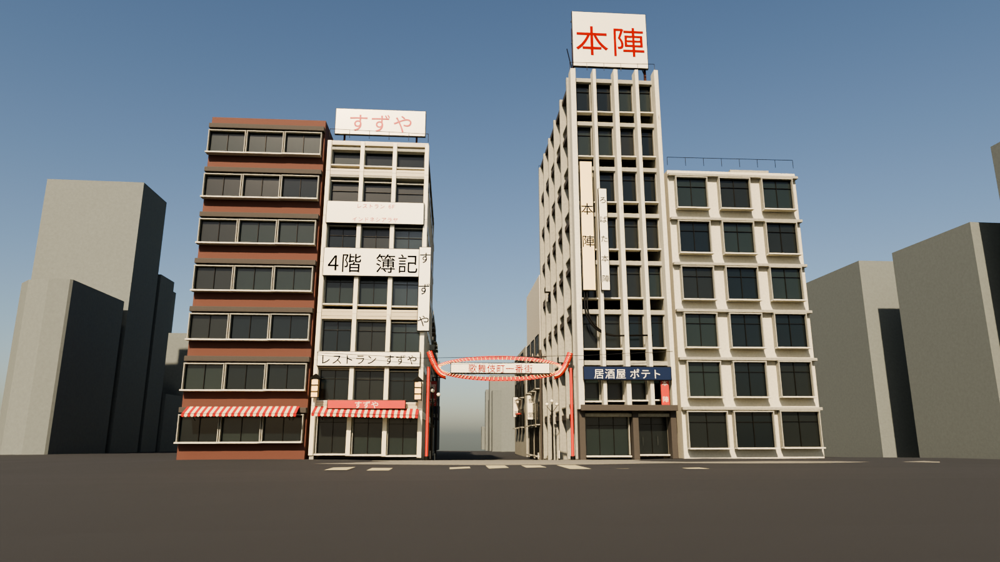
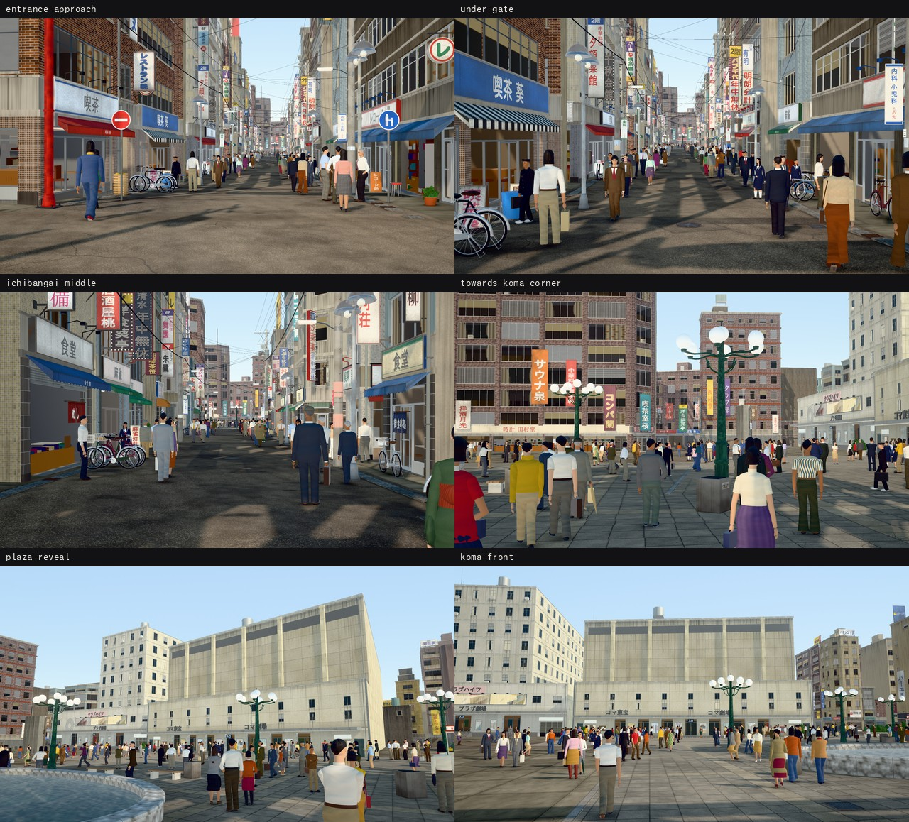

# Showa Tokyo 3D

昭和の東京を、史料を参照して歩ける3D街区として再構成するプロジェクトです。長回しの映像制作に使える、地区・年代ごとの空間とカメラ動線を蓄積します。

## 最初の地区

- 地区：新宿・歌舞伎町
- 目標年代：1976年前後
- 最初の経路：歌舞伎町一番街入口から旧コマ劇場前
- 現在の成果：制作採用版の3D街区、全地物の分類、歩行軌道、three.jsのコード生成による1080pの確認静止画（r04）

1976年前後の**制作採用版**を作成しました。門・コマ劇場・隣接する東宝会館・広場の形を決め、取り込んだ建物423件・道路176件・地形1件の全600地物に、置換・省略・推定背景などの扱いを記録しています。資料で決まらない寸法・色・配置は、根拠と反証を残した推定として採用しました。

[採用版の案内・再生成手順](docs/RECONSTRUCTION_ADOPTED_1976.md)から、[採用3Dモデル](scenes/shinjuku/kabukicho/1976/models/reconstruction-adopted.gltf)、[全地物の分類](data/derived/kabukicho-feature-classification.json)、[地形に沿う歩行カメラ](scenes/shinjuku/kabukicho/1976/cameras/adopted-walk.json)を取得できます。[採用判断と検査の記録](docs/rounds/shinjuku-kabukicho-1976-r03-completion.md)も公開しています。

「分類完了」「採用決定」は、600地物の1976年当時の姿をすべて史料で確認したという意味ではありません。現代の輪郭を使った背景は当時の建物へ見立てた制作上の推定であり、看板の一般的な業種名は実在店の同定ではありません。長編の写真品質映像・人物・車・音響の完成とは区別します。



入口画像は、同じ地理原点と門の採用値を使う別の精密スタディです。全街区の採用glTFから描画した6視点と歩行フレームは[採用版の案内](docs/RECONSTRUCTION_ADOPTED_1976.md)で確認できます。

元の[現代の下敷き](scenes/shinjuku/kabukicho/1976/models/modern-baseline.gltf)、[R01配置検討モデル](scenes/shinjuku/kabukicho/1976/models/layout-study.gltf)、[取り込み・修正記録](docs/DATA_INTAKE_R01.md)も保持しています。

## コード生成の静止画（r04）

採用版と同じ世界を、three.jsのコード生成で作り込みました。地面・建物419棟・看板約1,090枚・人物約580人・門と劇場・街路の小物を、外部の画像や3Dモデルを使わずにコードだけで生成し、GPUのない環境で1920×1080の静止画を1枚約40〜60秒で描きます。



[r04のラウンド記録](docs/rounds/shinjuku-kabukicho-1976-r04.md)に、独立批評の採点・指摘・修正、未解決の事項を記録しています。

- 見た目の合格条件（独立した映像批評担当2人がそれぞれ全項目8点以上）には、まだ達していません。最大の弱点は人物の造形です。
- 静止画のユーザー承認と動画（15秒の試写）は、まだです。
- 看板の店名は架空の名前と一般的な業種名です。服装・光・季節（10月上旬の晴れた午後）は、見た目の作業上の選択です。

描画の手順：

```sh
npm ci
node scripts/render_stills.mjs --out renders/r04 --w 1920 --h 1080
node scripts/render_stills.mjs --out renders/r04 --views r04-gate-establishing,r04-gate-rear,r04-milano-front
node scripts/render_stills.mjs --out renders/r04-walk --walk 0,60,120,184,257
npm run serve
```

`npm run serve`を実行すると、ブラウザで歩いて見られます（WASDで移動、1〜6で地点を切り替え）。フォントは端末に入れたものを使います：`fonts-ipafont-gothic fonts-ipafont-mincho fonts-motoya-l-maruberi fonts-motoya-l-cedar fonts-wqy-zenhei`。

## 構成

| パス | 内容 |
| --- | --- |
| `scenes/<ward>/<district>/<year>/` | 地区・年代ごとのシーン、モデル、テクスチャ、カメラ |
| `viewer/` | three.jsのコード生成ビューア（地面・建物・看板・人物・ランドマーク・小物の生成処理） |
| `scripts/render_stills.mjs` | ヘッドレスChromiumで静止画を描き、描画記録（根拠の段階・架空店名・環境）を書く |
| `data/sources.json` | 外部データ・史料の出典と確認状況 |
| `data/decisions/` | 門・劇場・広場・舗装の採用値、根拠、反証、推定範囲 |
| `data/derived/kabukicho-feature-classification.json` | 全600地物の採用・置換・省略の分類 |
| `docs/PRODUCTION_PLAN.md` | 制作順、反復方法、独立批評と合格条件 |
| `docs/templates/` | ラウンド記録と独立批評の依頼テンプレート |
| `docs/ASSET_POLICY.md` | データの利用条件・出典・再構成の記録方法 |
| `assets/shared/` | 複数地区で使う、利用条件を確認した共通アセット |

最初のシーン定義は `scenes/shinjuku/kabukicho/1976/scene.json` です。将来は別の地区や年代を、別のシーンとして追加できます。

## 制作方針

1. PLATEAUやOpenStreetMapを現在の位置関係の下敷きにし、当時の地図・航空写真・実写に沿って復元する。
2. 静止画・試写はthree.jsとヘッドレスChromiumで、すべてコードから生成する（2026-11-02にユーザーが承認）。Blender等は、導入手順と版を記録した場合だけ使う。
3. 承認したカラー参考画の光・素材感を目標にする。写真ごとの年代差や、白黒資料から推定した色は記録する。
4. 一つの街区と時間軸を共通の土台にし、曲がる前後や遮蔽物の前後でも建物・看板・人物が連続するようにする。
5. 地理の整合性、歴史考証、制作上の採用判断、映像の自然さを分けて評価する。資料で決まらない部分は明示した推定を採用し、未確認の細部を「99%正確」と認定しない。

## 画像の基準データ

[承認済みカラー参考画9枚のマスター](scenes/shinjuku/kabukicho/1976/references/README.md)を原寸PNGで保存しています。3D制作の光・色・素材感はこの画像セットに合わせます。年代・建物の同定・推定範囲は別途記録しています。

## 制作の進め方

出典付きの街区骨格から始め、入口の一角を高品質に仕上げてから全経路へ展開する。**街区の下敷き → 歩ける簡略モデル → 入口の一角 → 6視点の静止画 → 15秒の試写 → 全経路・4K出力**の順で進める。

各ラウンドで同じカメラの比較画像を作り、歴史・地理と映像表現を独立した批評担当で確認する。6視点の画づくりと15秒試写の歩行感を確認してから、長時間の最終レンダーへ進む。詳しい提出物と合格条件は[制作ワークフロー](docs/PRODUCTION_PLAN.md)にまとめている。

承認済み9枚と原資料の対応は[参考画の索引](docs/REFERENCE_INDEX.md)へ記録しました。採用版では門・劇場正面・広場工作物・推定の店先を立体化し、全経路の舗装と静的な障害物を検査しています。画づくりと長回しの最終映像は、採用した同じ世界と歩行軌道を使って仕上げます。

## データとライセンス

プロジェクトが新規に作成するコードと設定は [MIT](LICENSE) です。第三者の3Dデータ、地図、写真、テクスチャの条件は、その配布元とアセット別の記録を優先します。ルートやモデルを追加するときは、[アセット方針](docs/ASSET_POLICY.md)に従って出典・年代・利用条件を記録してください。

大容量の制作ファイルはGit LFSで管理する想定です。配布元の巨大な原本と本番レンダーは通常のGit履歴に入れず、取得方法・加工手順・チェックサムを記録します。

この再構成は歴史資料そのものではありません。確認済みの内容と、推定・演出的な補完を区別します。
