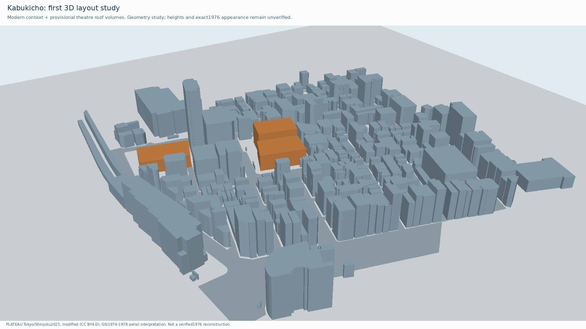
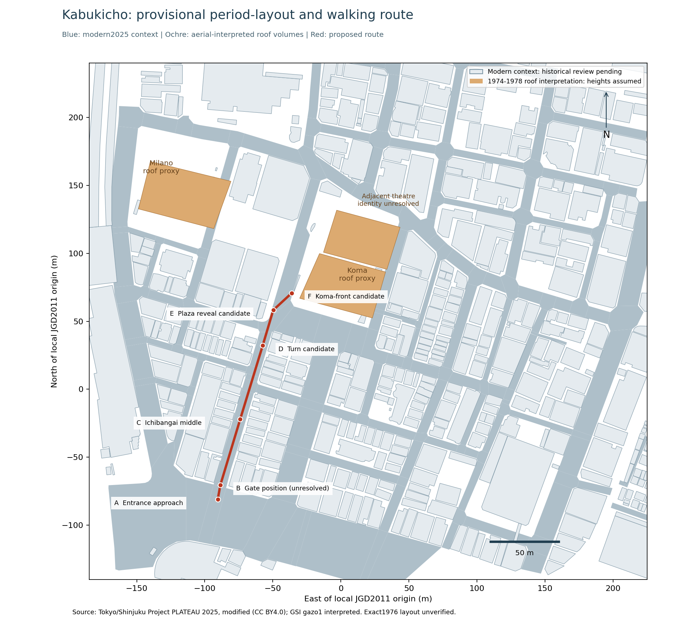
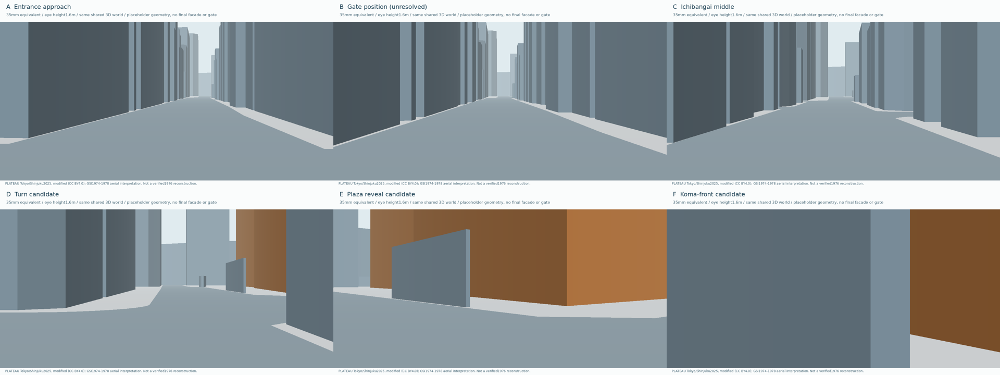
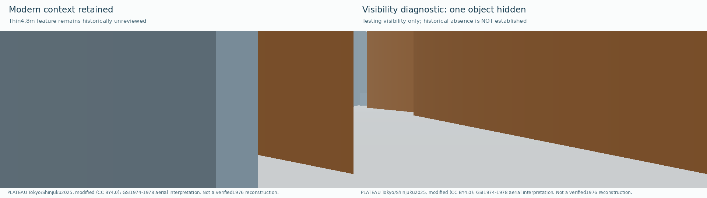
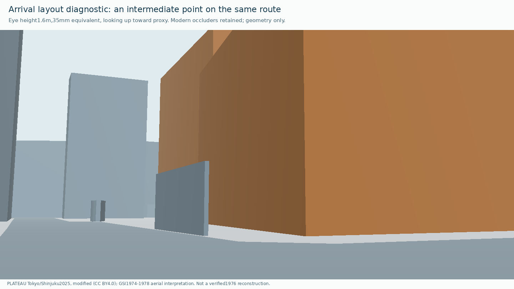

# 第1ラウンド：歌舞伎町の街区骨格

実際のPLATEAUデータを取り込み、一番街入口から旧コマ劇場前までの経路候補を同じ座標空間に配置した。建物423件・道路176件を取り込んだ現代の下敷きと、劇場跡地の一部を仮の体積に置き換えた配置検討用モデルを分けて保存している。

これは位置とカメラの検討用。店舗外観、看板、門、人物、舗装、1976年の全建物はまだ復元していない。下の図の青系の建物は現代データ、黄土色は航空写真から読んだ屋根輪郭を仮の高さで立ち上げたもの。色は検討用の区別であり、当時の外壁色を示さない。





## 今回の成果物

| 成果物 | 内容 |
| --- | --- |
| [現代の下敷きモデル](../scenes/shinjuku/kabukicho/1976/models/modern-baseline.gltf) | PLATEAUのLOD1、建物423件・道路176件、10,048三角形。元の地物IDを保持 |
| [仮の年代配置モデル](../scenes/shinjuku/kabukicho/1976/models/layout-study.gltf) | 現代の大きな2地物を外し、ミラノ座、旧コマ劇場候補、北隣の同定未確定な劇場棟の屋根輪郭を仮体積として追加。6カメラを含む |
| [カメラ経路案](../scenes/shinjuku/kabukicho/1976/cameras/route-proposal.json) | 同一座標空間の6地点。現在の案で約164m。実際の歴史的な歩行距離ではない |
| [取得・加工の台帳](../data/derived/kabukicho-intake-manifest.json) | 配布URL、元ZIPと抽出ファイルのSHA-256、件数 |
| [配置仮説](../data/kabukicho-layout-hypothesis.json) | 航空写真上のトレース位置、仮の高さ、差し替えた地物ID、未確認事項 |
| [9枚の参考画の対応表](REFERENCE_INDEX.md) | 実写の年代、用途、経路との関係、原典の確認状況 |

`.gltf`はバッファを内包し、単体で読み込める。通常のGitで差分と取得を扱えるテキスト形式として保存した。ローカル再生成では同じ内容のGLBを`renders/r01/`へ出力する。GLB等の制作バイナリをリポジトリへ追加する場合は、既存方針どおりGit LFSを使う。

## 根拠と精度

- PLATEAUは新宿区2025年度版、同梱READMEの作成日は2026年3月13日。属性や形状の原典年代は2018年撮影、2022年度の調査等が混在する。2025年の一斉実測や1976年の証拠とは扱わない。
- ZIP内のREADMEで利用者がCC BY4.0等から選択できることを確認し、今回の派生データにはCC BY4.0を選択。出典と加工内容をアセット別に記録した。
- 元座標はEPSG:6697の緯度・経度・高さ。GRS80の局所接平面を使い、X=東、Y=上、Z=南、メートルへ変換した。原点はJGD2011で緯度35.6945・経度139.702の任意の作業原点であり、現地の測量標ではない。
- 建物ごとの地面高さを0へ揃え、建物内の相対高さを保持した。道路は平面。起伏、段差、歩道縁石、絶対標高は未再現。
- 国土地理院の`gazo1`、ズーム17の4タイルから1974〜1978年の屋根と道路空間を読んだ。正確な撮影日は未確認。屋根の倒れ込みや影を含み、地上の建物外周とは一致しない場合がある。
- 航空写真のWeb地図座標とJGD2011の位置を近似的に対応させた。元期を含む厳密な座標変換は未実施。仮に置いた水平不確かさ5mは検証済みの誤差範囲ではない。
- 16m・20m・28mという仮体積の高さは造形上の仮定であり、当時の実測寸法ではない。北側の輪郭は旧コマ劇場の一部と断定せず、隣接劇場棟として同定を保留した。

## 動線と視点の検査

経路案の中心線を最大0.5m間隔、335点で検査した。このモデル内で建物の底面内部に入った点は0、建物外周までの最小距離は約1.52m。これは静的な仮形状に対する検査であり、1976年当時の通行可能性、人体全体、路上の物、起伏、動く人物や車の検査ではない。



終点付近は、歴史的な存在を確認していない現代の薄い地物が見通しを遮っている。共通モデルには残し、下図の右側だけ非表示にして影響を比較した。非表示は歴史的な不在の認定ではない。終点の厳密な入口位置や建物の正面軸も未確定。





静止画は同じ3D世界から出力したが、連続歩行、カメラの補間、人物、看板文字、ちらつき、音響の検査はまだ行っていない。今回の6枚を、画づくりを承認する段階の完成静止画とは扱わない。

## 再生成

Python3.11以降。取り込みとモデル書き出しは標準ライブラリで動く。

```sh
python scripts/import_plateau.py --archive /path/to/13104_shinjuku-ku_pref_2025_citygml_1_op.zip
python scripts/build_blockout.py
python -m unittest discover -s tests -v
```

公式配信元から取得する場合は、最初のコマンドを`python scripts/import_plateau.py --download`に置き換える。元ZIPのSHA-256が取得時の固定値と異なる場合は処理を止める。更新版を無確認で置き換えない。

プレビュー生成は追加依存を入れて実行する。既定フォントはDejaVu Sansであり、フォントのインストール場所が異なる場合はスクリプトの`FONT`を設定する。

```sh
python -m pip install -r requirements-render.txt
python scripts/render_blockout.py
```

## 次に閉じる資料の不足

1. 一番街の門：1972年の直線状の門と1978年の湾曲した門、および組合の1969年以来という説明に差がある。1976年の形状・寸法を確定する。
2. コマ劇場の正面：博物館写真ID9073（1977年3月の目録）と、1976年の住宅地図を調べ、入口と隣接劇場棟を同定する。
3. 経路中間の店並びと広場：現代の地物を当時の建物・工作物へ置き換え、見通しを再検査する。

[東京都立図書館の住宅地図総合目録](https://www.library.metro.tokyo.lg.jp/lib_info_tokyo/house_map_union_catalog/shinjuku/)では1976年の新宿区住宅地図（資料ID1124345680・1124337796）の所蔵を確認した。地図の紙面は未閲覧。

以上を進めながら、入口近景の窓・庇・看板を制作するための資料を補う。撮影日、門、劇場正面が未確定のため、歴史考証の合格は保留する。
