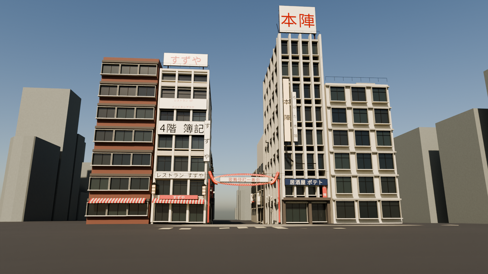
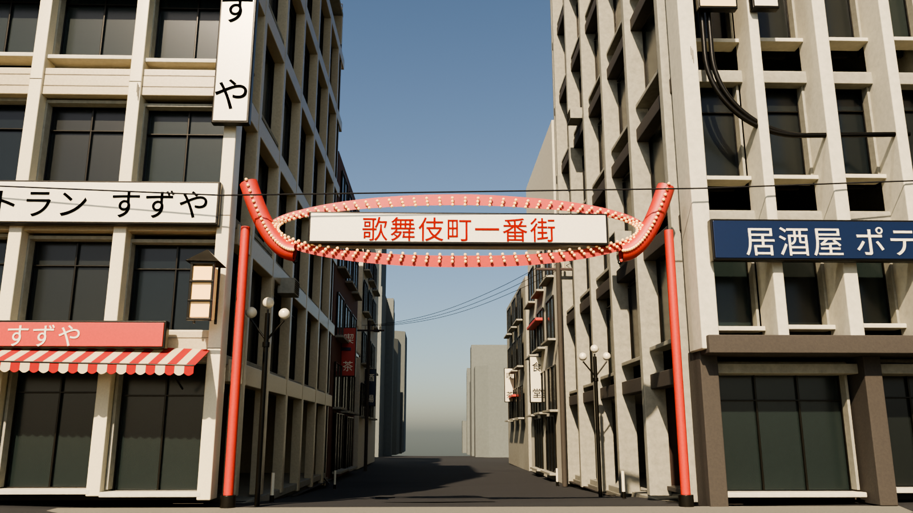
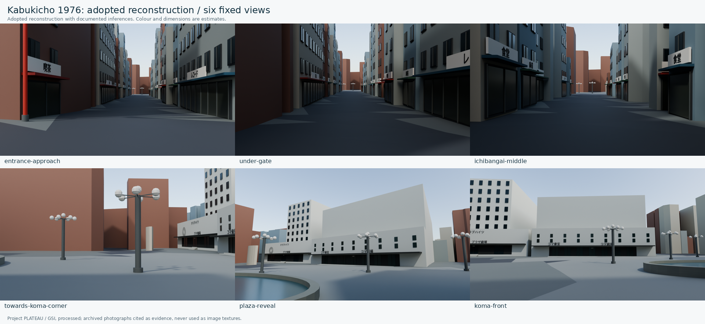
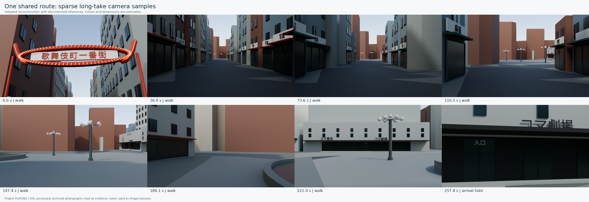

# 歌舞伎町1976年・制作採用版

一番街入口から旧コマ劇場前までの再構成について、門・劇場・広場・舗装・背景地物の採用判断を完了した。資料で決まらない部分は、2026年11月2日のユーザー指示に基づく推定として形・寸法・色・配置を定めている。

ここでの「完了」は、制作に必要な値と全地物の扱いを決め、モデルと歩行軌道へ反映したという意味である。全600地物の1976年当時の存在・外観を確認済みにしたものではない。写真品質の長編映像、人物・車・音響の完成とも区別する。

## 使うファイル

| 用途 | ファイル |
| --- | --- |
| 現行の制作モデル | [reconstruction-adopted.gltf](../scenes/shinjuku/kabukicho/1976/models/reconstruction-adopted.gltf) |
| 全600地物の扱い | [kabukicho-feature-classification.json](../data/derived/kabukicho-feature-classification.json) |
| 立体形状と部材・文字の定義 | [kabukicho-period-features.json](../data/derived/kabukicho-period-features.json) |
| 採用した建物正面・部材の仕様 | [period-scene-spec.json](../scenes/shinjuku/kabukicho/1976/reconstruction/period-scene-spec.json) |
| 地形に沿う長回し用カメラ | [adopted-walk.json](../scenes/shinjuku/kabukicho/1976/cameras/adopted-walk.json) |
| 舗装分類・連続離隔・カメラの検査 | [kabukicho-route-completion.json](../data/derived/kabukicho-route-completion.json) |
| 描画設定・入力モデルのハッシュ | [kabukicho-period-render-manifest.json](../data/derived/kabukicho-period-render-manifest.json) |
| 採用判断と検査の記録 | [R03完了記録](rounds/shinjuku-kabukicho-1976-r03-completion.md) |
| 光・色・素材感の目標 | [承認済みカラー参考画9枚](../scenes/shinjuku/kabukicho/1976/references/README.md) |

glTFはバッファを内包する。元の[現代の下敷き](../scenes/shinjuku/kabukicho/1976/models/modern-baseline.gltf)と[R01配置検討モデル](../scenes/shinjuku/kabukicho/1976/models/layout-study.gltf)は別に保持しており、採用判断を後から戻せる。新モデルの具体的な値を、現代元データや史料そのものへ書き戻していない。

## 採用したことと根拠

| 対象 | 制作の既定値 | 確認事実と推定の境界 |
| --- | --- | --- |
| 一番街の門 | 赤い曲線型、白い看板、赤い立体文字、暖色の白熱電球、奥行きと裏面を持つ金属構造 | 主資料は掲載者が1978年・吉野純治撮影と帰属した実写。1976年へ2年遡る形状、色、寸法、裏面は推定。1972年の直線型との不一致を記録し、掛け替え年は創作していない |
| 南側の劇場棟 | 新宿コマ劇場。西側を広場へ向く正面に採り、低い前面、入口、小窓、庇、「コマ劇場」「コマ東宝」の文字を配置 | 東宝の施設史、1957年ごろの実写、航空写真を照合。古い外観を1976年まで継続させること、入口軸、寸法、淡い鉱物質の外壁色は推定。1957年の庇の文字は「コマ東宝」「コマシネマ」と読め、「コマ劇場」の文字列は写真で確認できない（施設名による制作上の選択）。1975・1979年の写真では、広場側の北端は窓のない白い壁で、「KOMA」の輪の紋章と映画館コマ東宝の掲示がある。採用版の北端（1957年の様式）とは食い違い、未解決（[r05の見直し](rounds/shinjuku-kabukicho-1976-r05-data-review.md)） |
| 北隣の劇場棟 | 新宿東宝会館。低層のプラザ劇場前面と、後退したクラブハイツ側高層部を別の形にする | 東宝の1969年10月竣工記録、二つの跡地を区別する2011年発表、1975年・1979年実写に基づく。「コマ東宝」と「東宝会館」を同じ施設名として扱わない |
| 広場の噴水 | 楕円形の水盤、縁、水面と噴水を採用 | 航空写真の楕円状地物と後年の新宿区記録を根拠に置く。中心、寸法、向き、稼働状態は採用値 |
| 街路灯・階段 | 複数球の街路灯3基、劇場入口の段差・階段を立体化 | 写真にある様式を採用。正確な球数、配置、高さ、踏面寸法は推定。通行検査では実際に出力した外形を障害物として扱う |
| 道路と広場の継ぎ目 | 独立した舗装接続面を採用 | R01の未分類4点は元道路外周から約0.064〜0.347m離れた継ぎ目に集中。航空写真で続く街路と読める部分を接続面にし、新しい実測道路とは呼ばない |
| 劇場入口前の舗装 | 広場から採用入口前へ続く前庭の舗装面を補い、入口前で停止する | 採用した正面と入口の位置に対応する制作上の接続。史的な前庭外周の測量ではない |
| その他の街並み | 現代の輪郭を足場に、年代を想定した高さと店先へ作り替える | 当時の存続が確認できない建物は推定背景。一般的な「喫茶」「食堂」「理容」等の文字は制作した業種表示で、歴史的な実在店舗の同定ではない |

判断の原本は、[門](../data/decisions/kabukicho-gate-1976.json)、[劇場・広場](../data/decisions/kabukicho-koma-plaza-1976.json)、[ミラノ座](../data/decisions/kabukicho-milano-1976.json)、[背景建物の規則](../data/decisions/kabukicho-context-massing-1976.json)、[舗装の継ぎ目](../data/decisions/kabukicho-route-surfaces-1976.json)に分かれる。ミラノ座と背景建物の規則は、r03では生成スクリプトの中の値だったものを、r05の見直しで判断ファイルへ移した。各判断の`revisions`に、改訂前の値と改訂の根拠・反証・代案を残す。各判断は、採用値、原典URL、原資料の年、支える範囲、推定、反証、退けた案を持つ。詳しい照合は[門の記録](research/r03-gate-adoption.md)と[劇場・広場の記録](research/r03-koma-plaza-adoption.md)を参照。

未年代の緑色のコマ劇場写真や、原画素を見ていない博物館写真9073を、確認済みの1976年外観根拠へ追加していない。公演・映画番組の絵柄や日付は資料がないまま創作して掲出しない。写真の原画像や生成参考画を、モデルの貼り付けテクスチャとして複製していない。

## 全地物の分類

取り込み元600地物のIDごとに、処置、判断ID、根拠ID、推定状態、生成先IDを記録する。

| 処置 | 件数 | 意味 |
| --- | ---: | --- |
| 推定の年代背景 | 418 | 現代の外周を空間の足場に使い、高さ・近景の店先を制作する。当時の建物の存続認定ではない |
| 歴史配置へ置換 | 2 | 劇場跡地を覆う現代地物を、ミラノ座・コマ劇場・東宝会館の採用形状へ差し替える |
| 広場・舗装として省略 | 3 | 広場を覆う地物と薄い地物、劇場前の小建造物（r05）を採用年代モデルから外す。現代の下敷きには残す |
| 道路配置の参照 | 176 | 現代の道路を位置の足場として採用し、地面は同じTINへ合わせる |
| 地形参照 | 1 | 現代DEMを共通の地面として採用する |
| 未分類 | 0 | 空欄のまま残した取り込み元地物はない |

418件をまとめて「当時の建物だった」とする判断は行っていない。推定背景は1階3.2mを基準に、最低6.4m、経路から38m以内では高さ上限24m、それ以外では28mとする制作ルールを採用し、近景に店先を加えている。r05で、元の高さが5m未満で経路から38m以上離れた小さな地物（24件）は、6.4mへ引き上げず元の高さのままとした。これらは史料から測った当時の階高・高さではない。ルールも機械可読の採用判断として保存する。

採用モデルは装飾と文字を含む987地物・143,381三角形（r05の改訂後。r03時点は988地物・143,425三角形）。元の600地物の件数と、追加した部材の件数は分ける。日本語の固定文字45件を押し出しメッシュとして含み、写真を貼り付けた看板ではない。

## 座標・歩行・検査

シーンは1単位=1m、右手系のX=東・Y=上・Z=南。原点はJGD2011の緯度35.6945、経度139.702、基準標高32m。建物と地形は元の標高から32mを引く。現代DEMの採用は、1976年の地面高の確認ではない。

R01の6地点は固定診断用として保持する。長回し用の`adopted-walk.json`は別の軌道で、地形から目線1.6m、35mm相当を固定し、歩行・減速・停止・振り向きを同じ時間軸へ記録する。E・Fの固定診断画像は24mm相当であり、35mmの長回しと同一構図ではない。

採用歩行軌道は、R01の広角診断点Fを通過した後も、コマ劇場の採用した入口前まで進む。固定6地点の最後をそのまま長回しの終点にはしない。噴水や階段を避け、入口前で減速・停止して建物へ視線を向ける。

地形上の経路長は231.972m。減速・停止・振り向きを含む採用時間は257.833秒（約4分18秒）。Fの先へ約36.675m進み、採用した入口面の9m手前の前庭で止まる。入口位置自体は採用した西側正面と入口比率から求めた推定であり、史的な測量点ではない。

0.25m以下の間隔と停止中の姿勢を含む1,196標本で舗装の未分類は0件。線分全体を面境界で分割した検査でも未分類の長さは0mだった。建物外周422件と工作物16件に対して、半径0.35m・高さ1.8mの身体を想定した連続区間の静的検査を行い、衝突は0件。全経路の最接近は噴水で、中心線から外形まで1.939m、身体半径を引いた余裕は1.589m。到着点は入口階段から身体半径を引いて6.830m離れる。門の上部は下面5.4mを通過部として扱う。

最初は門へ視線を上げ、16mの間に通りの目線へ戻す。標本上の最大移動速度は約1.000m/s、最大角速度は約35.0°/s。姿勢は同じ時間軸で計算する。ジャークと通常速度での全フレーム再生は未検査であり、数値的な軌道検査だけで長編動画の歩行感を認定していない。

これらは採用したデジタル形状に対する検査である。推定配置の不確かさや、当時の群衆・車・未記録の路上物まで通過を保証するものではない。

## カラーの確認画像





入口近景4枚は、共通の地理原点・門の採用値を使う別の精密スタディから、1600×900、Cycles・48サンプルで描画した。988地物の採用glTFそのものに入口の詳細シーンを合成済みとは扱わない。窓・看板・店先・門の奥行きを確認する建築的なカラー描画である。人物・車は入れておらず、承認カラー参考画と同等の写真品質へ達したという認定は行わない。広角の入口構図は固定経路と別の診断カメラで、`entrance-approach`と`entrance-under-gate`は共有経路の35mm相当の視点を保つ。





全街区の6視点と歩行の8枚は、r03時点の採用glTF（コミット`c2fb75a`のモデル）から描画した。r05の改訂（コマの名称の取り付け、ミラノ座の正面幅、街路灯2基、低い背景建物）の後のモデルとは違う。比較用のスタディとして残し、描画記録（`data/derived/kabukicho-period-render-manifest.json`の`archived_study`）にその旨を記録した。歩行8枚は同じ立体空間・同じ軌道から出した疎な確認画像であり、全フレームを描画した動画ではない。個別画像は`docs/previews/r03/period-<camera-id>.png`と`period-walk-00.png`〜`period-walk-07.png`に保存する。

独立した技術・史料・静止画の検査では、分類・採用判断・空間・初期カラーの確認として合格となった。公開PNGは入口4枚、全街区14枚、一覧2枚の計20枚。36テストと全73アセットのハッシュ・依存関係も検査している。ガラス・背景・店先の密度や、184.1秒付近の壁中心の構図は、最終映像の仕上げで調整する範囲として残す。

## コード生成による作り込み（r04）

r04では、この採用版を共通の世界として、three.js 0.170.0のコード生成で地面・建物・看板・人物・ランドマーク・街路の小物を作り込んだ。採用判断の値（門・劇場・噴水・街路灯の形と位置、固定文字45件、歩行軌道、固定6地点のカメラ）は変えていない。ただし、次の2点はr04の制作で採用値に近づけて描き直した。

- 東宝会館の円形意匠：採用値どおり3重の輪として描く。r05の見直しで、1975・1979年写真の輪の紋章は「KOMA」の欧文字を含み、コマ劇場側の壁にあると読み直した。東宝会館の紋章とする採用は反証つきの未解決事項。
- ミラノ座：上部の窓2段×10を採用部材どおり戻した。

描画手順、独立批評、未解決の事項は[r04のラウンド記録](rounds/shinjuku-kabukicho-1976-r04.md)に、代表画像は`docs/previews/r04/`にある。

r04の批評で、採用データどうしの食い違いが見つかった。いずれも採用判断を見直す必要があり、r04では変えていない。r05で採用判断を改訂した（[r05の採用データの見直し](rounds/shinjuku-kabukicho-1976-r05-data-review.md)）。

- コマ劇場の名称の文字（中心3.8m、字高0.85m）の下端が、庇の上端（約3.39m）とほぼ同じ高さにある。地上の目線からは、どの距離でも下端が庇に隠れる。歩行の到着点（正面から9m）では、およそ下半分が隠れる。
- ミラノ座の採用正面の北側約12mの前、約2.4mの位置に、推定背景の建物（現代の敷地を足場にした高さ28m）が立っている。

## 再生成

Python 3.11以降とBlender 4.5 LTSを使う。初回取り込みの元ZIP・抽出・ハッシュ確認は[R01の手順](DATA_INTAKE_R01.md)を維持する。公開済み派生データから採用版だけを再生成する場合は次の順で実行する。

```sh
python scripts/complete_route.py --decisions-only
python scripts/build_period_scene.py
blender --background --factory-startup --python scripts/render_period_scene.py -- --font /path/to/NotoSansCJK-Regular.woff2 --prepare-text-meshes
python scripts/build_period_scene.py
python scripts/complete_route.py
blender --background --factory-startup --python scripts/render_period_scene.py -- --font /path/to/NotoSansCJK-Regular.woff2 --output renders/r03/period-final --width 1280 --height 720 --samples 32 --walk-samples 8
python scripts/assemble_completion_previews.py --input renders/r03/period-final
python scripts/update_completion_metadata.py --require-complete
python -m unittest discover -s tests -v
```

`--decisions-only`は接続舗装・劇場前庭・到着位置の判断データだけを準備し、未生成の工作物を通過検査済みとは扱わない。モデルと文字の生成後に、オプションなしの`complete_route.py`で最終の通過検査を行う。

CJKフォントはBlender配布物のNoto Sans CJK SC Regular WOFF2で実行確認している。別のフォントを使う場合も、その利用条件を確認してパスを指定する。文字はBlenderで立体メッシュへ変換されるため、後続フレームで文字列が生成し直されて変わる仕組みではない。書体の細部は制作上の採用であり、当時のロゴの輪郭を一致確認したものではない。

入口近景の詳しいカラー描画は別の制作スクリプトで再生成する。

```sh
blender --background --factory-startup --python scripts/build_entrance_detail.py -- --font /path/to/NotoSansCJK-Regular.woff2 --output renders/r03/entrance-final --gate curved --engine cycles --width 1600 --height 900 --samples 48 --views entrance-calibration,entrance-gate-study,entrance-approach,under-gate --publish-preview-dir docs/previews/r03
```

元データを再取り込みした場合は、先に`python scripts/build_blockout.py`と`python scripts/update_asset_metadata.py`を実行する。採用版用のメタデータは最後に`update_completion_metadata.py`で更新する。モデルや画像を変更したらハッシュ検査をやり直す。

`renders/`の中間出力はGitの対象外。公開用静止画は対応する生成マニフェストと隣接メタデータを持つ。元写真の権利と、派生モデル・コードのライセンスは別に扱う。

## 完了と残す不確かさ

この版では、全地物の扱い、主経路、門・劇場・広場の主要形状を決めずに保留する項目をなくした。原資料で確定できない年代・色・寸法は推定のまま記録し、モデルへ反映している。新しい史料が得られれば採用値を差し替えて再生成できる。

静止画、歩行軌道、静的な身体離隔の検査は、群衆・車・看板・音響を含む長編動画の検品を置き換えない。最終映像は、この採用版の共通空間を使って画づくりと動きを仕上げる。
