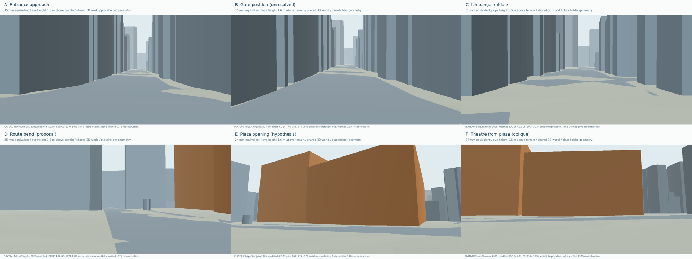
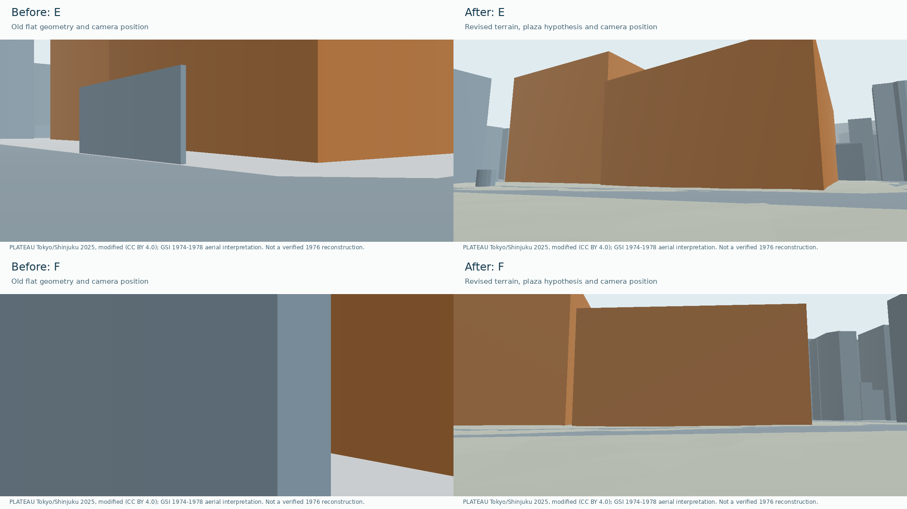

# ラウンド記録：shinjuku-kabukicho-1976 / R01外部レビュー対応

## 比較条件

- 対象：第1ラウンドの配置検討モデル、6地点のカメラ、地形・年代・出典メタデータ。外部レビューの6項目に対応する。
- 元コミット：`bb31effa95b3f12ed53e9b1e530f7cb8299b1a66`。結果はこの文書を含む改訂コミット。
- 実施日：2026年11月2日。開始・終了時刻と総所要時間は未計測。
- 目的：広場と曲がり角を確認できる視点、共通の高さ基準、地物の調査年、アセットごとの追跡可能な出典を揃える。歴史考証や写真品質の合格は対象外。
- 承認範囲：既存リポジトリの修正・再生成・検査。最低待機時間は設けない。有料API・外部GPUは使用していない。
- 資料：PLATEAU新宿区2025年度版の同じ固定ZIP、同梱DEM、国土地理院gazo1の1974〜1978年航空写真4タイル、1975年の広場写真。航空写真の正確な撮影日と資料間の厳密な地理対応は未確定。
- カラー目標：承認済みR01〜R09の`master-v1`を維持。今回の簡易描画の色は現代地物・仮体積・地形を見分けるための表示色であり、当時の色の復元ではない。
- カメラ：A〜Fの6地点。A〜Dは35mm相当、E・Fは屋根と広場を同時に見る診断用24mm相当。地形から目線1.6m。季節・時刻・天候・写真用露出は未設定。動画・共通タイムラインの検査は未実施。
- 実行環境：Python 3.12.14。取り込み・モデル生成は標準ライブラリ、形状プレビューはNumPy 2.3.5・Pillow 12.3.0・Matplotlib 3.10.8のCPU描画。6地点は1280×720、コンタクトシートは1920×720。

## 今回の修正と成果物

| 問題ID | 場所 | 変更内容 | 成果物 | 状態 |
| --- | --- | --- | --- | --- |
| 1 | D・E・F | 広場の範囲を明示。Dを72.184°曲がる地点へ移し、Eを広場への接続と劇場候補全体、Fを広場の奥から見る斜めの視点へ分け、両方24mm相当で屋根と足元を示す | [配置仮説](../../data/kabukicho-layout-hypothesis.json)、[経路](../../scenes/shinjuku/kabukicho/1976/cameras/route-proposal.json) | 再配置・再生成・独立批評で形状確認用として合格 |
| 2 | 広場の現代地物 | 薄い地物と広場を覆う地物の2件を配置検討モデルから除外する仮説を記録。舗装・噴水の航空写真解釈が主根拠、1975年写真は広場の存在の補助根拠。現代の下敷きは保存 | [配置仮説](../../data/kabukicho-layout-hypothesis.json) | 仮説として記録・再生成済み |
| 3 | 地形・高さ | 共通基準標高32m、同梱TIN、建物の元標高、地形に沿うカメラを導入。高さ0の道路は頂点をTINへ配置 | [地形](../../data/derived/kabukicho-terrain.json)、[取り込み台帳](../../data/derived/kabukicho-intake-manifest.json) | 実装・再生成済み |
| 4 | 出典 | 各アセットの配布元・原典・加工・依存IDを個別化。配置モデルのglTF単体にも両出典を記載 | [メタデータ更新スクリプト](../../scripts/update_asset_metadata.py) | 31件を個別更新し、全40件のハッシュ・依存関係を検査済み |
| 5 | 調査年 | `source_creation_date`と`source_survey_year`を分離し、不明値`0001`は`null`、元文字列は別に保持 | [取り込み台帳](../../data/derived/kabukicho-intake-manifest.json) | 380棟が2021年・43棟が不明 |
| 6 | 英語説明 | 図・JSONの説明文で数字前後の空白を修正 | [描画スクリプト](../../scripts/render_blockout.py)・アセットメタデータ | 図・説明を修正して再描画済み |

## 実測・検査

| 項目 | 方法・範囲 | 結果 | 限界 |
| --- | --- | --- | --- |
| 元データ | 固定ZIPと抽出ファイルのSHA-256、地物選択を再実行 | 建物3,024件から423件、道路918件から176件。元ZIPと既存5ファイルは既存ハッシュを維持、DEMを追加 | 同じ配信版の再現性であり史実の証明ではない |
| 地形 | 同梱DEMをストリーム処理し、選択地物の全頂点を覆う範囲のTINを保持 | 8,926頂点・17,478三角形。選択範囲内26.99〜37.5428m、保持範囲全体26.99〜37.57m | 現代の地形参照。1976年の高さ、階段・縁石は未確認 |
| 地形の被覆範囲 | 独立した検査で地物の水平座標を照合 | 建物・道路の異なる水平頂点3,533点すべてが保持TIN内 | 地物を覆うことの検査であり1976年の地形を証明しない |
| 現代・配置モデル | 共通基準標高を適用して再出力 | 現代27,526三角形＝建物・道路10,048＋地形17,478。配置検討27,278三角形 | 道路面内部は頂点間の平面近似 |
| 建物の調査年 | 元GMLの`uro:surveyYear`を抽出 | 2021年380棟、不明43棟。作成日・配信年度と区別 | 単一時点の現在の街並みを表さない |
| 経路・6カメラ | 最大0.5m間隔の中心線検査 | 地点間3D折れ線195.282m、397点、建物内部0点、最小離隔2.881m。現代道路内279点・広場仮説内114点、重複0点。いずれにも含まれない4点は通行可能性未確認 | 静的な中心線検査は人体全体・車・路上物の通過を保証しない |
| リポジトリテスト | `python -m unittest discover -s tests -v` | 18件すべて成功。地形補間、共通標高、道路配置、調査年、カメラの向き・画角、Dの曲がり、広場内の地点、地物除外、ハッシュ・依存関係・glTF内出典を検査 | 歴史考証・連続歩行・写真品質を判定しない |
| Blender再読み込み | Blender 4.5.15 LTSで両glTFを読み込み、出力と経路を照合 | 現代600メッシュ・27,526三角形、配置599メッシュ・27,278三角形。6カメラの位置・向きが経路JSONと一致 | 写真用素材・歴史考証・動画の検査ではない |
| Khronos公式検査 | 今回の改訂モデルに対する実行 | 未実施 | 外部レビューによる旧モデルの0件報告を今回の実行結果とは扱わない |
| メタデータ | 更新後のSHA-256・ID・依存先・出典範囲 | 31件の個別メタデータを更新。維持した参考画9件を含む全40件でハッシュ一致・依存先解決を確認 | 第三者原本の転載許可を追加認定するものではない |

経路長は6地点を結ぶ3D折れ線の合計で、地形の細かな起伏に沿って積分した距離ではない。入口の地面高32.8968mに対し、改訂後の終点は30.7899m。E・Fの注視点の地面からの高さ10m・8mと24mm相当の広角は診断の構図設定値であり、劇場の歴史的寸法ではない。

主観による見え方の評価を、史実の一致率として扱わない。

## 独立批評

制作側の自己採点を渡さない新しい文脈の担当が、技術・出典と静止画の構成を別々に検査した。旧R01の批評結果を今回の合否へ流用していない。

- 技術・出典担当：取り込み・地形・経路・モデル・メタデータ・テストを独立に確認。18テスト、40件のハッシュ・ID・依存関係、シーンと経路の一致、地形による全3,533水平頂点の被覆を確認し、改訂データの構造・追跡可能性は合格と判定。
- 静止画担当：6視点、俯瞰図、改訂前後・地物比較を検査。最初のE・F案は壁を大きく映す問題が残り、再配置・広角化・注視点を修正。改訂E・Fと俯瞰図は検討用の形状確認として合格。
- 同担当はその後、Dが近くの壁を大きく映す退行も検出。地点と経路は保ち、Dの注視方向だけを広場へ向け直した。最終のD・E・F、6視点一覧、俯瞰図、改訂前後と到着時の比較を改めて確認し、形状・経路の検討用として合格、致命的・重大な構成上の問題は残っていないと判定した。

| 指摘 | 重大度・対応 | 最終状態 |
| --- | --- | --- |
| E・Fが壁中心で広場や劇場候補の全体を読めない | 重大。広場範囲を明示し、地点・注視点・画角を再検討 | 屋根・足元・広場・角の関係を確認でき、解消 |
| E・F改訂後にDが近くの壁を大きく映す | 重大。Dの位置・経路を保ち、注視方向を広場へ修正 | 最終個別画像と6視点一覧で解消を確認 |
| Eの屋根の一部が画面から切れる、一覧の注記が小さい | 軽微。診断用途の範囲として許容、注記は個別画像で読む | 本編構図の調整時に再確認 |
| Fの劇場正面軸、歴史的な寸法・外観 | 資料不足。斜めの仮体積確認として明示 | 歴史考証は保留 |

歴史的な建物の同定や広場境界を合格としたものではない。連続動画、音響、人物・看板の検査は今回行っていない。

## 判断と引き継ぎ

- 判定：R01の取り込み・配置検討・出典修正として合格。技術と静止画構成の独立批評を終えた。歴史考証と最終的な画づくりの合格は保留。
- 次に確認すること：道路・広場仮説の範囲外となった検査点4点の通行可能性、噴水・段差・路上物、連続カメラの補間。
- 広場の境界、歴史的な地物の除外、屋根の高さは明示した仮説。現代の下敷きを別モデルに残し、判断を戻せるようにする。
- 一番街の門の1976年形状、コマ劇場と隣接劇場棟の正確な同定・入口・正面軸、経路中間の店並びは資料不足が残る。
- ユーザーによる今回の静止画・歩行感の確認は未実施。動画の本番レンダーへ進む承認を意味しない。
- 生成AIによる画像生成・動画生成は今回0回。簡易形状プレビューを再描画。外部GPU費用0、総ツール使用量・所要時間は未計測。
- 再開時は[取り込み結果](../DATA_INTAKE_R01.md)、配置仮説、経路、取り込み台帳を読む。以後もモデル・画像を再生成したら、メタデータ更新とテストを最後に実行する。
