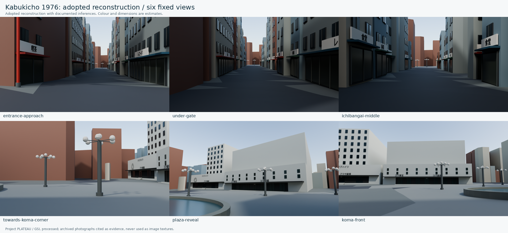
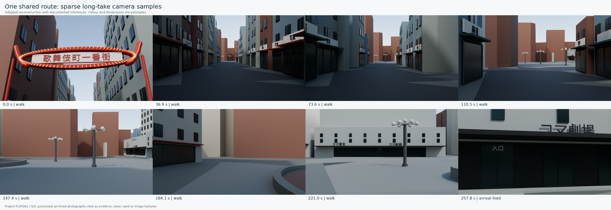

# ラウンド記録：shinjuku-kabukicho-1976 / R03採用版

## 比較条件

- 対象：門・劇場正面・広場工作物・舗装の採用判断、全地物の分類、採用モデル、地形に沿う歩行軌道、カラー静止画。
- 元コミット：`51dabf78e03db1936de144e3dfde3eb2a259010a`。結果は本記録を含む改訂コミット。
- 実施日：2026年11月2日。開始・終了時刻と総所要時間は未計測。
- ユーザー指示：「分類、考証も含めて全部完成させよ。どうしてもわからなければ、お前が推測してよい」。制作に必要な判断と値を完了させ、推定を確認事実へ昇格させない。
- 目標年代：1976年前後。資料は1957年ごろ・1971〜1979年などの実写、国土地理院1974〜1978年航空写真、所有者・所蔵者・地域の記録。現代PLATEAUとDEMは位置・高さの足場。
- カラー目標：承認済みR01〜R09の`master-v1`。元画像9枚を変更しない。
- 描画セット：全街区の6視点・歩行8枚は同じ採用glTFから描画。入口近景4枚は共通の地理原点・門の採用値を使う別の精密スタディであり、採用glTFへ詳細シーンを合成済みとは扱わない。
- 画面条件：固定診断6地点を保持。長回し軌道は35mm相当・地面から目線1.6m。季節・撮影日の史実認定は行わず、色と光は制作上の採用設定。
- 実行環境：Python 3.12、Blender 4.5.15 LTS。標準ライブラリでデータ生成、Blenderで立体文字とカラー静止画を描画。有料API・外部GPUを使用していない。

## 今回の採用と成果物

| 問題ID | 対象 | 変更内容 | 成果物 | 結果 |
| --- | --- | --- | --- | --- |
| R03-1 | 門の年代・形 | 1978年実写の曲線型を1976年へ遡って採用。寸法、色、電球、裏面を具体化。1972年直線型の反証を保存 | [門の採用判断](../../data/decisions/kabukicho-gate-1976.json) | 推定採用を完了 |
| R03-2 | コマ劇場・東宝会館 | 二棟を区別し、西側の正面・入口・窓・庇・階段・文字・色を採用。低い前面と後退した高層部を別形状にする | [劇場・広場の採用判断](../../data/decisions/kabukicho-koma-plaza-1976.json) | 推定採用を完了 |
| R03-3 | 広場 | 楕円の噴水、複数球の街路灯、入口階段を立体化。実際の外形を経路検査へ渡す | [採用モデル](../../scenes/shinjuku/kabukicho/1976/models/reconstruction-adopted.gltf) | 工作物16件を出力し、連続離隔を検査 |
| R03-4 | 未分類の舗装4点 | 元道路の外周から約0.064〜0.347mに集中する継ぎ目を特定し、独立した接続舗装を採用 | [舗装判断](../../data/decisions/kabukicho-route-surfaces-1976.json) | 採用面に分類 |
| R03-5 | 全地物 | 600件を、推定背景、歴史配置へ置換、省略、道路・地形参照へ分類。空欄を残さず生成先を追跡 | [全地物の分類](../../data/derived/kabukicho-feature-classification.json) | 全600件を分類 |
| R03-6 | 立体・文字・描画 | 店先、窓、庇、看板、劇場名を立体化。CJK文字をメッシュへ変換し、カラー静止画と歩行の疎な確認フレームを出力 | [採用版の案内](../RECONSTRUCTION_ADOPTED_1976.md) | 公開PNG20枚を出力。空間・初期カラー確認の範囲で独立批評を完了 |
| R03-7 | 到着地点 | 固定診断点Fの先へ歩行軌道を延ばし、採用したコマ劇場入口前で停止。広場から前庭へ続く舗装面を補う | [採用歩行軌道](../../scenes/shinjuku/kabukicho/1976/cameras/adopted-walk.json) | 入口前の到着・静的離隔を検査 |

## 実測・検査

| 項目 | 方法・範囲 | 結果 | 限界 |
| --- | --- | --- | --- |
| 採用3Dモデル | 部材・看板文字を生成してglTFへ書き出し | 988地物・143,425三角形、glTF15,330,293バイト。固定CJK文字45件を立体メッシュとして含む | 追加部材を含む件数であり、988棟の歴史的建物を意味しない |
| 門・材料の仕様対応 | 採用値と出力形状・材料を独立に照合 | 門の幅約10.640m・高さ7.8m、電球318球（楕円270＋両端48）。門・コマ・東宝会館の材料色が採用値を反映 | 採用した制作値との一致であり、当時の実測寸法・球数・色の証明ではない |
| 保持した旧成果 | R01のモデル・カメラ・プレビューと、参考画・付帯情報を改訂前と照合 | R01の派生モデル・カメラ・プレビューと参考画9枚の18パスは変更なし | 新しい採用モデルと歩行軌道は別ファイル |
| 全地物の分類 | 取り込み元IDと処置・生成先IDを照合 | 全600件を分類、未分類0。推定背景419、置換2、省略2、道路176、地形1 | 歴史的な存続の全件確認ではない |
| 元の未分類4点 | 元道路外周との距離と採用接続面への包含を照合 | 元外周から約0.064〜0.347mの継ぎ目に集中し、接続舗装へ分類 | 接続面の史的な輪郭・舗装色は推定 |
| 採用歩行の舗装 | 0.25m以下の標本と、全線分を面境界で分割した連続区間検査 | 1,196標本の未分類0、連続未分類長0m | 採用した道路・広場・接続面に対する検査 |
| 静的な身体離隔 | 建物外周422件・工作物16件、半径0.35m・高さ1.8mの身体を想定 | 衝突0。最小中心線離隔1.939m、身体半径を引いた余裕1.589m。最接近は噴水。門は下面5.4m | 配置・寸法は推定を含む。群衆・車・未記録の路上物は対象外 |
| 歩行軌道 | R01のFから採用入口前まで約36.675m延長。現代TINへ接地し、移動・停止・回転を時間順に計算 | 距離231.972m、採用時間257.833秒、最大標本速度約1.000m/s、最大標本角速度約35.0°/s。入口面9m手前の前庭で停止 | ジャーク、通常速度の全フレーム再生は未検査 |
| 入口カラー静止画 | Blender 4.5.15 LTS、Cycles、48サンプル、CPU8スレッド | 1600×900を4枚。3,079オブジェクト。1枚約34.83〜65.52秒。PNGデコードと記録したハッシュを確認 | 建築的なカラー描画。人物・車なし。独立した画面批評を別に記録 |
| Khronos公式検査 | 今回の採用モデルに対する実行 | 未実施。公式配布物の取得を試みたがタイムアウト | リポジトリ検査・Blender読み込みと、公式Validatorの検査を混同しない |
| 全街区のカラー描画 | Blender 4.5.15 LTS、Cycles、32サンプル、1280×720 | 固定6視点＋歩行8時点の14枚を同じ最終モデルから描画。1枚約18.46〜27.02秒 | 歩行は疎な標本で、全フレーム動画の描画ではない |
| 公開画像と入力の対応 | PNGデコード、マニフェストのSHA-256・モデル・歩行姿勢を照合 | PNG20枚＝全街区14枚＋一覧2枚＋入口4枚。全街区14枚は最終モデルと現行の歩行姿勢へ対応 | 入口4枚は別の精密スタディ |
| リポジトリテスト | `python -m unittest discover -s tests -v` | 36件すべて成功。分類、形状、文字外形、採用値・材料色、地面、身体離隔、カメラ、出典を検査 | 史実の確定や写真品質、全フレーム再生の判定ではない |
| メタデータ | 新規33件を更新し、既存を含む全レコードを検査 | 73件・73個の一意なID。ハッシュ不一致0、依存先・出典IDの未解決0、依存グラフの循環0 | 参照写真の転載許可を認定するものではない |

全地物を分類したことは、600件の史的な存続・外観を確認したという意味ではない。推定背景の419棟は、現代輪郭を空間の足場に使い、高さと店先を制作する扱いである。原資料の不確かさや推定の範囲は各判断とアセットの付帯情報へ残す。

## 独立批評

制作側の自己採点を渡さない新しい文脈の史料・実装担当と、静止画担当が別々に確認した。史料・実装担当は、史料と採用判断、出力された形状の対応を確認した。東宝の施設史・1969年竣工記録・2011年の二跡地区別、写真掲載者の1978年帰属、1957年・1975年・1979年の写真説明と、後年の新宿区による噴水の存在記録を照合している。

歴史・採用判断の担当は、600件の処置と具体的な採用値が揃い、原典と推定の区別・反証が保たれていることから、推定を認めた制作採用版として合格とした。1976年の全事実や「99%正確」を認定したものではない。

| 指摘 | 対応 | 最終状態 |
| --- | --- | --- |
| 噴水が採用した半径の半分になり、17°の向きも形状へ反映されていない | 半径キーと回転を修正し、採用した楕円を物理的な外形として出力 | 採用値と形状の対応を確認 |
| 複数球の街路灯3基が型名の不一致で生成されない | 型の対応を修正し、支柱・基礎・灯具を出力 | 地上の外形を工作物の検査へ渡す |
| 劇場が従来の全高の箱のままで、低い前面と後退した塔が実際の形になっていない | 前面と背後のボリュームを作り直し、窓・入口・階段・固定文字を追加 | コマと東宝会館の別棟・前面を確認 |
| 東宝会館の入口が庇へ重なる | 入口上端3.9m・庇下面4.15mの採用値を適用 | 0.25mの隙間を確認 |
| CJK文字が指定高さより小さく、看板の中心からずれる | フォントの数値上のサイズに依存せず、生成した文字の実際の外形を指定高さと中心へ合わせる | 45件の文字メッシュで高さ・上下中心の一致を数値確認。最終描画で可読性も検査 |
| 歩行の終点が広角診断点Fで、劇場の入口前へ着いていない | 採用入口前まで軌道を延長し、前庭舗装と身体離隔を再検査 | 入口面9m手前の前庭で停止する到着を出力 |

技術担当の最終検査も合格。36テスト、73アセットのハッシュ・一意なID・出典と依存関係、988地物・45件の立体文字・16工作物と採用判断の対応を確認した。全街区14画像が最終モデルと現行の歩行姿勢へ対応し、公開20 PNGすべてをデコードできることも確認した。

静止画担当は、空間と初期カラーを確認する段階として合格と判定した。文字の外形・中心を合わせたことで門と劇場名が読めるようになり、到着位置を入口面から9mへ引いた画像では建物名・庇・入口・階段を同時に確認できる。コマと東宝会館の区別、広場の物理的な工作物も読み取れる。

仕上げ上の制約として、ガラスが暗く均一であること、背景・店先の密度が単純であること、疎な歩行標本の184.1秒付近が壁中心の構図になることを記録した。これらは分類・採用判断の完了を妨げないが、長編映像を完成とする前に素材・細部・視線を調整する対象である。今回の判定を、写真品質や全フレームの歩行映像の合格へ置き換えない。

## 判断と引き継ぎ

- 判定：分類、歴史資料に基づく採用判断、物理的な街区モデル、入口前までの歩行軌道、出典追跡の整合性として合格。制作を止めていた項目は、確認事実または明示した推定の採用値として完了した。
- 対象外の完成認定：1976年の全事実の確定、写真品質の長編映像、人物・車・音響、通常速度での全フレーム再生。
- 採用した門・建物の正面・広場工作物・舗装の値は、資料の年と推定を分けて保存する。後から同じ入力と手順で変更できる。
- 1972年と1978年の門の食い違いを解消したと装わない。未年代の緑のコマ劇場や未閲覧の博物館9073を、1976年の確認済み外観根拠へ加算しない。
- コマ東宝と、1969年竣工の東宝会館を混同しない。実在が確認できない公演・映画広告の図柄や日付を捏造して掲出しない。
- 現代の元モデル、R01診断モデル・カメラ、承認済みカラー参考画9枚を保持する。
- 長編の写真品質映像、人物・車・音響の検品は別の制作段階であり、静止画や軌道の検査結果で代用しない。
- 生成AIによる新しい画像・動画生成は今回0回。カラー静止画は採用した立体空間からBlenderで描画。外部GPU費用0、総ツール使用量・所要時間は未計測。
- 再開は[採用版の案内・再生成手順](../RECONSTRUCTION_ADOPTED_1976.md)、`data/decisions/`、地物分類、採用モデル、歩行軌道から行う。
