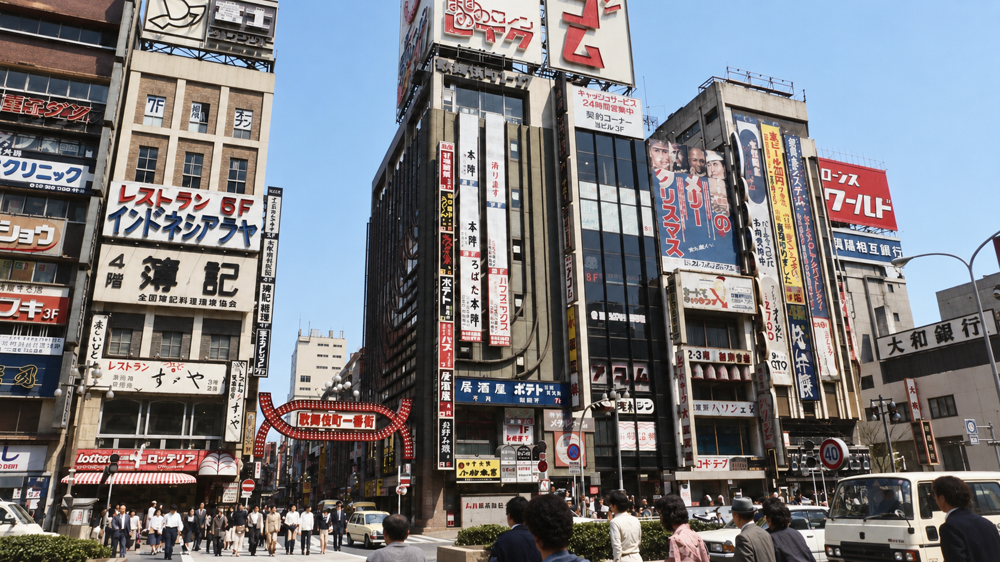
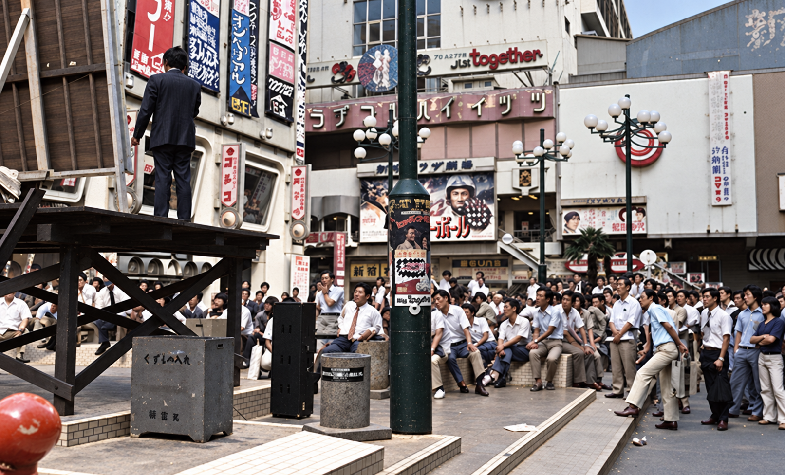
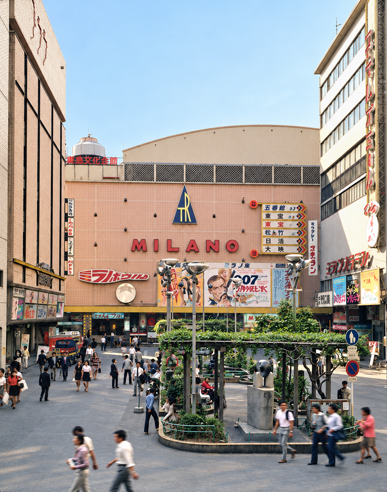
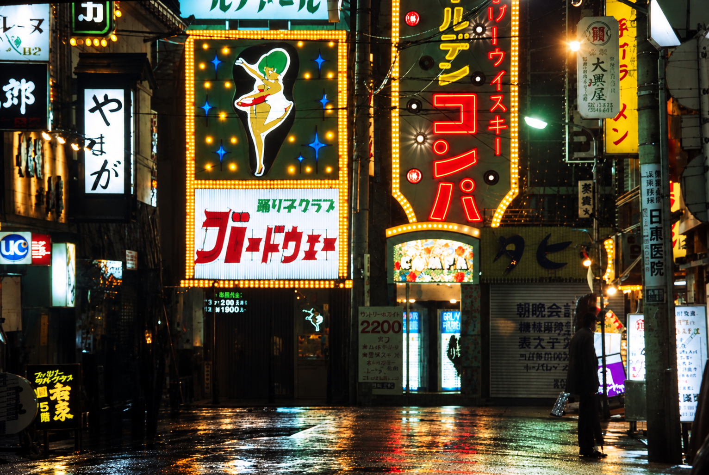
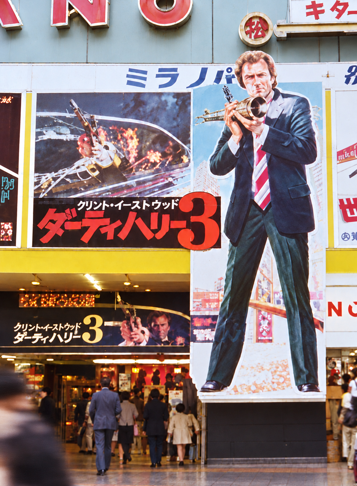
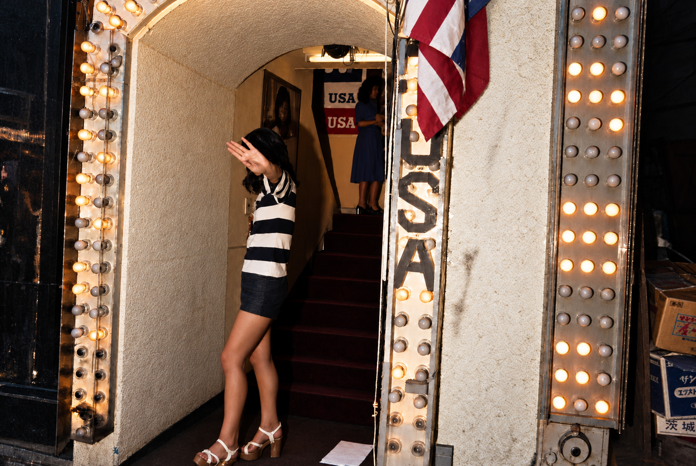
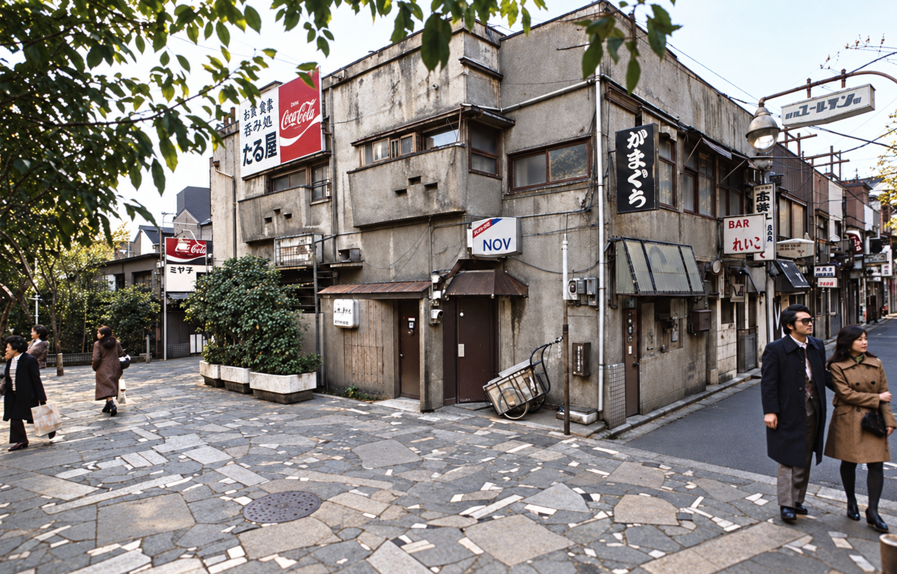
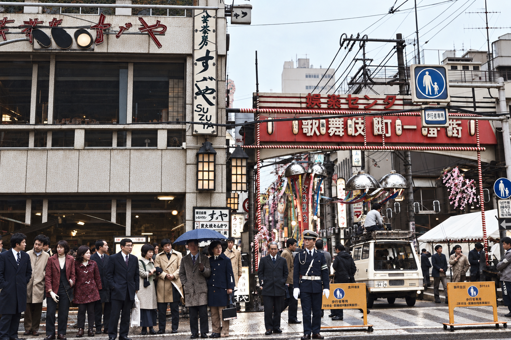
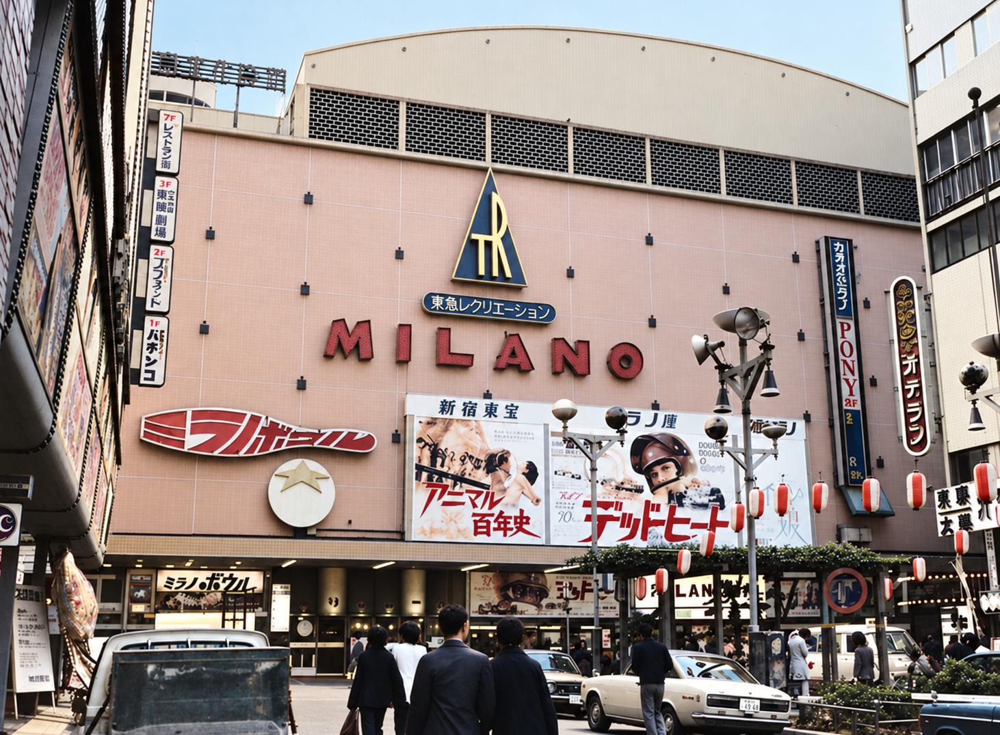

# 承認済みカラー参考画：マスターv1

この9枚を3D制作の見た目の基準データとする。ユーザーが承認した生成画像の原寸PNGを、再圧縮・拡大・切り抜きをせず保存した。各ファイルはSHA-256で識別できる。

当時の実写をもとにしたカラー再構成であり、原資料には年代差がある。色・微細な質感などの推定を含む。歴史考証や地理座標の証拠は、[参考画索引](../../../../../docs/REFERENCE_INDEX.md)と原典を別途参照する。

## 一覧

| 参考画 | 内容と用途 |
| --- | --- |
|  | **R01 一番街入口・昼の臨場感** 原資料：1978 入口の構図・周辺外観。門の1976年時点の形状は未確定。 |
|  | **R02 劇場前広場・人のいる午後** 原資料：1975 広場・街路灯と旧コマ劇場の一部。正面全体の根拠には不足。 |
|  | **R03 ミラノ座・カラー資料に基づく昼景** 原資料：1972 ミラノ座の外観・素材。コマ劇場とは区別。 |
|  | **R04 歌舞伎町・ネオンが照らす夜** 原資料：1977 看板と夜の光。経路上の正確な位置は未同定。 |
|  | **R05 ミラノ座入口・映画看板の実在感** 原資料：Venue slide says 1976; capture year uncertain ミラノ座の部分的な入口と広告。撮影年は未確認。 |
|  | **R06 Club USA・入口の光と質感** 原資料：1976 入口・階段・電球。住所と経路上の位置は未確認。 |
|  | **R07 ゴールデン街・昼の路地の空気** 原資料：1976 ゴールデン街。今回の経路の建物・道幅には使わない。 |
|  | **R08 一番街の旧門・街頭の人波** 原資料：1972 直線状の旧門。1976年までの存続・背面・寸法は未確認。 |
|  | **R09 ミラノ座正面・街を歩く視点** 原資料：1971 ミラノ座の1971年の外観。当年の広告を1976年へ転用しない。 |

## 使い方

- 光・色・素材・看板の構成を、対応するマスター画像と比較する。
- R03・R05・R09はミラノ座、R07は経路外のゴールデン街。別の建物へそのまま当て込まない。
- R01・R08は門の形状が異なる。1976年の門を確定したことにはしない。
- 修正案は新しい版・別名で追加する。`master-v1/`のPNGを上書きしない。
- 原寸・出典・推定範囲・SHA-256は[索引JSON](approved-colour-index.json)と隣接する`*.asset.json`に記録する。

## 権利の扱い

公開対象はユーザーが選んだ生成画像。第三者の原写真は含めていない。プロジェクトのコード用MITライセンスを画像へ自動適用せず、原資料の権利について追加の許諾を主張しない。
